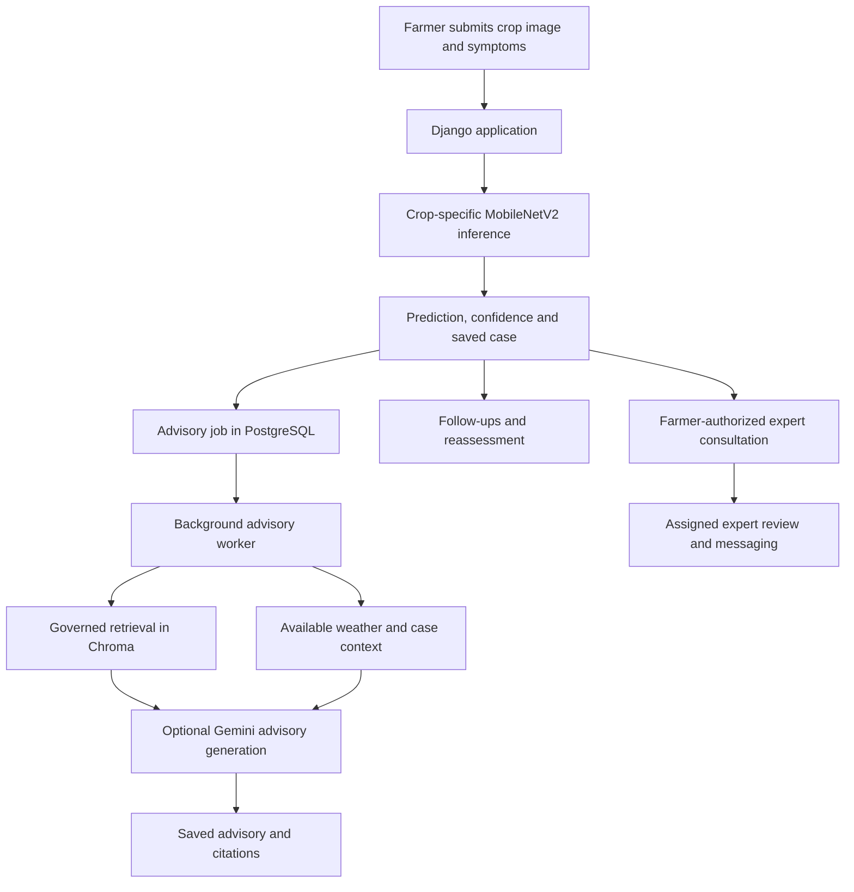

# FarmSra AI

**An integrated crop-health decision-support prototype for East African farmers.**

FarmSra AI is a university software-engineering project that brings crop-leaf image classification, evidence-linked agricultural guidance, local weather context, case history, multilingual assistance, and farmer-initiated expert consultation into a single web application. Its initial scope is **tomato, potato, and maize**, with **English, Swahili, and Amharic** interfaces.

> [!IMPORTANT]
> **Academic prototype — not a field diagnostic or professional agronomy service.** Image predictions are tentative, model confidence does not measure disease severity, and the educational-prototype knowledge base has not received professional agronomist sign-off or certified translation. Do not use its output as the sole basis for pesticide or other high-risk decisions.

## What the application does

| Area | Implemented workflow |
| --- | --- |
| Crop-health assessment | Farmer submits a crop, symptoms, location, and leaf photograph; the corresponding local MobileNetV2 model returns a class prediction and confidence. |
| Automatic advisory | A durable background worker retrieves eligible agricultural evidence, builds available case context, and processes a structured advisory request. The interface displays progress and preserves generated advisory versions. |
| Agricultural knowledge | A searchable guidance library and Chroma-backed retrieval use separately governed knowledge collections with source attribution. |
| AI assistant | A floating, case-aware chatbot supports crop questions, follow-up conversations, citations, and persistent history; external Gemini generation is optional, with labelled evidence-excerpt fallback when it cannot generate a valid answer. |
| Weather | Open-Meteo observations and forecasts can support the dashboard and case-specific weather snapshots, provided the location can be resolved unambiguously. |
| Case follow-up | Farmers can add symptoms and photographs, request reassessment, review parent/child case history, and mark recommendation actions complete themselves. |
| Expert consultation | A farmer selects an expert (or requests any available expert), explicitly consents to case sharing, exchanges messages, receives a review, and can revoke access. No referral is triggered automatically. |
| Accounts and language | Email-based authentication, separate farmer/expert/administrator permissions, and Django gettext interface catalogs for English, Swahili, and Amharic. |

### End-to-end workflow



The system is a **Django 5.2 modular monolith** using Django templates, CSS and JavaScript, PostgreSQL, TensorFlow/Keras, Chroma, and optional external services. Image inference runs locally; Gemini, if configured, is used for language generation rather than image classification.

## Model coverage

Three previously trained **MobileNetV2-based Keras classifiers** are integrated. They accept **224 × 224 RGB images**, with preprocessing defined by the saved models. The trained weights are supplied separately from this repository.

| Crop | Output classes | Accuracy reported in model export metadata |
| --- | ---: | ---: |
| Tomato | 10 | 93.59% |
| Potato | 3 | 98.15% |
| Maize | 4 | 96.35% |

These are **metadata-reported held-out accuracies**, not independently reproduced field-performance measurements. Class indices must retain the exact order from each crop's `*_classes.json` file. The tomato model also outputs **two-spotted spider mites**, which is identified as a pest result outside the disease-focused advisory scope. Low-confidence and healthy outputs receive conservative handling.

See [`docs/reference/MODEL_INTEGRATION.md`](docs/reference/MODEL_INTEGRATION.md) for the artifact contract, preprocessing, class counts, and validation caveats.

## Getting started (Windows / PowerShell)

### Prerequisites

- **Python 3.13** and `pip`
- **PostgreSQL** (via Docker Compose or a locally installed server)
- Sufficient storage and RAM for TensorFlow, Chroma, and the three Keras model files
- **Git**; **Docker Desktop** is optional if you already have PostgreSQL
- Network access for installing dependencies and for optional Gemini/Open-Meteo calls; first-time embedding-model setup may also require a download

### 1. Clone and install

```powershell
git clone https://github.com/Fiyametarose/FarmSra-AI.git
cd FarmSra-AI
py -3.13 -m venv .venv
.\.venv\Scripts\Activate.ps1
python -m pip install -r requirements.txt
Copy-Item .env.example .env
```

Edit `.env` and replace the placeholder `POSTGRES_PASSWORD` and `DJANGO_SECRET_KEY` values. Do not commit the file. If PowerShell refuses to activate the virtual environment, use `.\.venv\Scripts\python.exe` in place of `python` for the remaining commands.

### 2. Start PostgreSQL

The included `compose.yaml` starts PostgreSQL on **`127.0.0.1:5433`**:

```powershell
docker compose up -d db
```

The Compose database and user are both `farmsra`; its password is read from `.env`. If using an existing PostgreSQL installation instead, create the database and user and set `POSTGRES_DB`, `POSTGRES_USER`, `POSTGRES_PASSWORD`, `POSTGRES_HOST`, and `POSTGRES_PORT` accordingly (often port `5432`).

### 3. Install the trained model weights

Obtain the **separately distributed, trusted** model bundle and place the three `.keras` files at these paths:

```text
model_artifacts/
├── tomato/tomato_mobilenetv2_final.keras
├── potato/potato_mobilenetv2_final.keras
└── maize/maize_mobilenetv2_final.keras
```

The matching `*_classes.json` and `*_model_metadata.json` files are **already tracked** in this repository. Preserve their contents and exact class order. The project intentionally does **not** commit `.keras` weights, training datasets, or intermediate checkpoints. Use only model files from a trusted source.

### 4. Initialize the database and educational knowledge

```powershell
python manage.py migrate
python manage.py import_knowledge_archive --archive knowledge_assets/farmsra_rag_v6 --dry-run
python manage.py import_knowledge_archive --archive knowledge_assets/farmsra_rag_v6 --index
```

The tracked directory contains **69 Markdown documents** (23 topics × 3 languages) and **8 supporting metadata files**. This initialization imports them into PostgreSQL and builds the separate educational-prototype Chroma collection; repeat imports are designed to be idempotent.

For the **local university demonstration**, enable educational-prototype retrieval by adding or changing the following in `.env`:

```dotenv
RAG_EDUCATIONAL_PROTOTYPE_MODE=true
```

This is **off by default**. The imported documents remain unverified, inactive, and non-expert-reviewed under the `educational_prototype` approval scope; enabling this mode does **not** mark them professionally approved. Prototype citations and warnings remain visible in the application.

**Original knowledge sources are retained separately.** The 13 original Markdown files in `advisory/sources/` have a governed registration and approval workflow:

```powershell
python manage.py import_legacy_knowledge
python manage.py ingest_knowledge
```

`import_legacy_knowledge` registers those sources as **inactive, unverified drafts**. `ingest_knowledge` **only indexes existing database versions** that are active, verified, expert-reviewed, and approved; it does not automatically approve or import raw Markdown into the production collection. The two collections may coexist without treating prototype evidence as production-approved material.

### 5. Create accounts

```powershell
python manage.py createsuperuser
```

The superuser receives the administrator role. Use `/admin/` to create expert users, assign their **Expert** role, and complete their specialization, supported languages, availability, and service areas. Public registration is **farmer-only**. Farmer and expert accounts have separate dashboards and case-access permissions.

### 6. Start the application and advisory worker

Open **two PowerShell terminals** in the project directory and activate the same virtual environment.

**Terminal A — web server:**

```powershell
python manage.py runserver 127.0.0.1:9000
```

Open **http://127.0.0.1:9000/**. Port `9000` is a local example, not a project requirement; select another unreserved port if necessary. Set `APP_BASE_URL=http://127.0.0.1:9000` in `.env` when using this port for notification links.

**Terminal B — background worker:**

```powershell
python manage.py run_advisory_worker
```

The worker uses PostgreSQL to claim queued advisory jobs and **does not open an HTTP port**. A quiet terminal can be normal while there are no jobs. To process at most one job and exit, use `python manage.py run_advisory_worker --once`.

### Optional Gemini generation and external services

Set `GEMINI_API_KEY` in your local `.env` to enable Gemini-backed response generation. Set `GEMINI_ADVISORY_MODEL` to a model available to **your API key and API version**; model availability and quotas can change. The assistant can return clearly identified evidence excerpts when generation fails, but these excerpts are **not** successful live Gemini-generated answers. Case advisories may show an unavailable/retry state when evidence or generation is insufficient.

Weather uses **Open-Meteo**; it depends on network access and unambiguous locations. In-app notifications work without SMTP. Email delivery needs a configured email backend and SMTP settings; otherwise the default backend does not send real email.

## Key configuration

| Variable | Purpose | Default or example |
| --- | --- | --- |
| `POSTGRES_PASSWORD` | PostgreSQL password; required by Compose | Set locally in `.env` |
| `POSTGRES_DB`, `POSTGRES_USER` | Database and user | `farmsra` / `farmsra` |
| `POSTGRES_HOST`, `POSTGRES_PORT` | Database connection | `127.0.0.1` / `5433` |
| `DJANGO_SECRET_KEY` | Django signing secret | Set a long, unique local secret |
| `DJANGO_DEBUG` | Django development mode | `true` in `.env.example` |
| `RAG_EDUCATIONAL_PROTOTYPE_MODE` | Allow retrieval of prototype documents | `false` unless enabled |
| `GEMINI_API_KEY` | Optional Google Gemini access | Unset |
| `GEMINI_ADVISORY_MODEL` | Gemini model identifier | Set to an accessible model |
| `GEMINI_CHAT_TIMEOUT` | Chat answer request timeout | Configurable in `advisory/chat.py` |
| `APP_BASE_URL` | Links in notifications | `http://127.0.0.1:8000` unless overridden |
| `DJANGO_ALLOWED_HOSTS` | Allowed web hostnames | `127.0.0.1,localhost` |

Never commit API keys, passwords, `.env`, `.django-secret`, user uploads, generated embeddings, or local database contents.

## Run checks and tests

```powershell
python manage.py check
python manage.py makemigrations --check --dry-run
python manage.py test --noinput
python -m pip check
```

Django uses a separate test database; the test run needs PostgreSQL credentials with appropriate test-database permissions. The full suite may be resource-intensive because it includes model and RAG integration scenarios. Targeted tests can be run by app, for example:

```powershell
python manage.py test advisory.test_chat advisory.test_global_chat --noinput
python manage.py test expert_reviews diagnoses.tests.test_followups --noinput
python manage.py test advisory.test_prototype --noinput
```

The project was also exercised locally with Playwright browser automation for diagnosis, chatbot, expert consent and messaging, access revocation, and follow-up/reassessment. Those local QA scripts and screenshots are **not part of the tracked application**; do not interpret that testing as independently certified field accuracy or exhaustive browser compatibility.

After changing gettext `.po` files, rebuild the translation catalogs using:

```powershell
python compile_po.py
```

## Demonstration walkthrough

1. **Farmer:** Register or sign in, add a crop and location, and open **Diagnose Crop**.
2. **Diagnosis:** Upload a real tomato, potato, or maize leaf photograph; review the **tentative** prediction and confidence.
3. **Advisory:** Open the case to observe background processing and the available evidence-linked guidance or clear retry/unavailable status.
4. **Assistant:** Open the floating chatbot, ask a crop question, and review its citations and prototype notices. Demonstrate case-specific conversation and history.
5. **Case management:** Add a follow-up observation or photograph, trigger reassessment, and show the preserved assessment history and action tracker.
6. **Expert:** Initiate a consultation with explicit consent; demonstrate the assigned expert's review, two-way messages, and farmer revocation of access.
7. **Languages:** Switch between English, Swahili, and Amharic; describe any known limitations in dynamic content or external translation/generation.

For a predictable demo, use a **pre-tested specimen whose displayed photograph matches the actual inference run**, and preserve a completed case in case an external service becomes unavailable.

## Repository structure

```text
advisory/          # RAG retrieval, knowledge governance, chat, advisory jobs and actions
diagnoses/         # Upload, image inference, case history, follow-ups, reassessment
crops/             # Registered farmer crops
expert_reviews/    # Expert profiles, consent, assignment, messaging and reviews
weather/           # Geocoding, current conditions and case weather snapshots
notifications/     # In-app events and optional email delivery
users/             # Authentication, farmer profile, language and settings
config/            # Django settings and URL routing
knowledge_assets/  # Tracked educational-prototype RAG documents and metadata
model_artifacts/   # Tracked model metadata/labels; separate .keras weights
locale/            # English/Swahili/Amharic gettext resources
static/            # CSS, JavaScript and visual assets
docs/reference/    # Integration and design reference notes
```

## Prototype boundaries

- **Diagnostic validity:** The classifiers were evaluated on controlled held-out data according to their export metadata; field performance, calibration, disease severity, and treatment effectiveness have not been independently established.
- **Knowledge quality:** The multilingual educational collection is source-linked but not professionally approved or certified as translated. Governed production retrieval remains separate.
- **AI availability:** Gemini requests can fail or be rejected by evidence-grounding and chemical-safety checks. The chatbot may display source excerpts in their original English instead of a generated answer; case advisories can require retry.
- **Weather:** Geocoding refuses ambiguous matches rather than choosing coordinates arbitrarily. Weather availability, freshness, and saved snapshots depend on successful location resolution and provider access.
- **Expert identity:** Expert accounts and profiles are administrator-managed; the university prototype does not independently certify professional credentials.
- **Deployment:** The supplied setup is for local academic demonstration, not hardened production hosting, offline field operation, or autonomous agricultural treatment decisions.

## Project status and distribution

**Status:** University prototype with implemented and locally tested core workflows. It is not a production agricultural service.

This repository provides the web application, tracked model labels/metadata, and educational-prototype source documents. **Trained `.keras` weights and local runtime data must be supplied separately.**